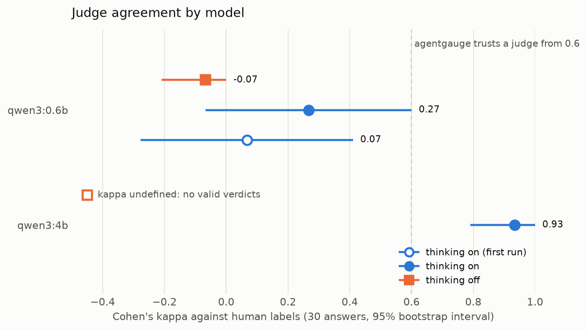

# Benchmarks: small local models as agents and as judges

What happens when you point agentgauge at small models on a laptop: can they pick the right tool, can they work through a multi-step tool loop, and can they be trusted to grade answers? Measured against a local [Ollama](https://ollama.com) server through its OpenAI-compatible endpoint. The first run was on 2026-11-05; the later rows on 2026-11-07 and 2026-11-10.

## Results

| Model | Size | Thinking | Kappa (95% CI) | Agent pass rate | Tool-call accuracy | Loop pass rate | Mean latency |
| --- | --- | --- | --- | --- | --- | --- | --- |
| qwen3:0.6b | 522 MB | on (first run) | 0.07 (-0.28 to 0.41) | 83% (10/12) | 78% (7/9) | not run | 778 ms |
| qwen3:0.6b | 522 MB | on (re-run) | 0.27 (-0.07 to 0.60) | 75% (9/12) | 67% (6/9) | 88% (7/8) | 1013 ms |
| qwen3:0.6b | 522 MB | off | -0.07 (-0.21 to 0.00) | 92% (11/12) | 89% (8/9) | 75% (6/8) | 161 ms |
| qwen3:4b | 2.5 GB | on | 0.93 (0.79 to 1.00) | 100% (12/12) | 100% (9/9) | 100% (8/8) | 5722 ms |
| qwen3:4b | 2.5 GB | "off" (switch had no effect, see below) | undefined (0 of 30 valid verdicts) | 100% (12/12) | 100% (9/9) | 88% (7/8) | 5734 ms |



- **Kappa** is the model acting as judge on 30 answers a human labelled (see [calibration](../calibration.md)). agentgauge warns below 0.6.
- **Agent pass rate** is the share of 12 single-decision prompts handled correctly: 9 that need one specific tool call, and 3 where the right move is to call nothing.
- **Tool-call accuracy** is the share of the 9 that need a call where the model made exactly the right call with the right arguments.
- **Loop pass rate** is the share of 8 multi-step tasks (see [`agent_loop_suite.yaml`](../../benchmarks/data/agent_loop_suite.yaml)) where the model made exactly the expected sequence of calls, within three calls, and finished. Tool results are scripted, so only the model varies.
- **Mean latency** is per case over the 12 single-decision prompts, run one at a time. Per loop task the means were 5595 ms and 452 ms for the 0.6b with thinking on and off, and 18426 ms and 28298 ms for the 4b.

## Interpretation

1. **Size mattered far more than thinking.** The 4B model was right on every tool decision and loop task and judged with kappa 0.93; the 0.6B model never reached the 0.6 trust line in any run, and its judging was no better than chance whichever way it ran. The 4B costs about 5 to 35 times the latency, and a loop task took 18 seconds.
2. **Thinking off helped the 0.6B as an agent and wrecked it as a judge.** Latency fell from about 1 s to 161 ms and single-decision accuracy rose from 6 of 9 to 8 of 9, but it called 29 of 30 answers wrong, and in two loop tasks it announced the timer in words instead of calling `set_timer`.
3. **Treat the small differences as noise.** There are 12 tool cases, 8 loop tasks and 30 judge labels, one case moves a rate by 8 to 13 points, and the same 0.6B setting gave kappa 0.07 and then 0.27 with overlapping intervals. Only the 0.6B against 4B gap is larger than that.

## The ablation: do the empty tool-call replies go away with thinking off?

For `qwen3:0.6b`, yes. The first run had two cases (Paris and Tokyo weather) where the endpoint returned `finish_reason: stop`, empty `content` and no `tool_calls`. With thinking off both returned the correct call. In the thinking-on re-run those two were still empty, and a third (Lima) was empty too, so the thinking-on failure is real but moves around between runs.

Thinking off is not a free fix: one currency prompt now came back without the amount (`{"from":"CAD","to":"USD"}`, scored `wrong_arguments`), and two loop tasks failed.

**How thinking was switched off.** `reasoning_effort: "none"` in the request body, sent through the new `extra_body` provider option. This is the OpenAI-compatible name Ollama accepts; `"think": false`, Ollama's native option, is ignored on `/v1/chat/completions` (measured: reasoning came back and `content` was empty). The details are in [ADR 0016](../adr/0016-extended-benchmark.md).

## Findings

**For `qwen3:4b`, thinking cannot be switched off through Ollama.** `reasoning_effort: "none"` and the native `think: false` both removed the `reasoning` field, but the model then reasoned in `content` instead, so latency did not change (5734 ms against 5722 ms). A `/no_think` suffix or system message only shortened the reasoning. The consequences are in the "off" row: all 30 judge replies were reasoning text rather than a JSON verdict, so kappa is undefined; the 12 single-decision tool calls were still all correct; and one loop task (`timer-then-weather`) ran away, making 17 tool calls (including `convert_currency` with `{"minutes":5}`) and ending with reasoning text as its answer. Recorded as it happened, not worked around.

**Empty replies instead of tool calls (0.6B, thinking on).** 2 of 9 in the first run and 3 of 9 in the re-run. The model's `reasoning` field says it will call `get_weather`, but the call never reaches the response. agentgauge scores this as `no_call`; the adapter does not read `reasoning`.

**Loop tasks the 0.6B got wrong.** Thinking on: on `sunny-no-timer` it made no call at all and returned an empty answer. Thinking off: on `rain-then-timer` and `hot-then-timer` it called `get_weather` and then said it would set the timer without calling `set_timer`.

**No malformed tool calls.** In single decisions every call that came back parsed as a JSON object (`malformed_arguments` and `malformed_response` are zero in all five runs). The only wrong-shaped arguments are the missing `amount` and `minutes` described above.

**Not reproducible across sessions.** Same settings, same machine, same Ollama, different day: the 0.6B's thinking-on run changed on one tool case and on three judge verdicts (kappa 0.07 to 0.27). Within a session two runs had been identical. Raw outputs also differ in tool-call ids and argument key order; the scorer compares parsed arguments, so scores are unaffected.

## How it was run

| | |
| --- | --- |
| Machine | arm64, Apple M2 Pro, 16 GB RAM |
| Server | ollama version is 0.40.14 |
| Endpoint | `http://localhost:11434/v1` (OpenAI-compatible) |
| Sampling | temperature 0, seed 42, max_tokens 2048 |
| Execution | one case at a time; judge cache off; loop capped at 5 steps |
| Python | 3.12.13 |

```bash
ollama pull qwen3:0.6b && ollama pull qwen3:4b
for model in qwen3:0.6b qwen3:4b; do
  for mode in on off; do
    uv run python benchmarks/run_benchmark.py --model $model --thinking $mode \
      --out docs/benchmarks/results/${model/:/-}-thinking-$mode.json
  done
done
uv run python scripts/plot_kappa.py
```

The benchmark is [`benchmarks/run_benchmark.py`](../../benchmarks/run_benchmark.py), the chart is drawn by [`scripts/plot_kappa.py`](../../scripts/plot_kappa.py) (matplotlib, a dev dependency), the data is in [`benchmarks/data/`](../../benchmarks/data/), and every per-case result, including each tool call and each loop route, is in [`results/`](results/). `qwen3-0.6b.json` is the original first run, kept as it was. Designs: [ADR 0013](../adr/0013-tool-use-benchmark.md) and [ADR 0016](../adr/0016-extended-benchmark.md).

## Limits

- Eight loop tasks with scripted tool results measure following a route in clean conditions, not recovering from tool errors or real tool behaviour.
- Twelve tool cases and thirty judge cases are small, and the judge set is easy general knowledge. Only one model family and two sizes were run.
- Results hold for this machine, this Ollama version and these model builds. Change any of them and re-run.
